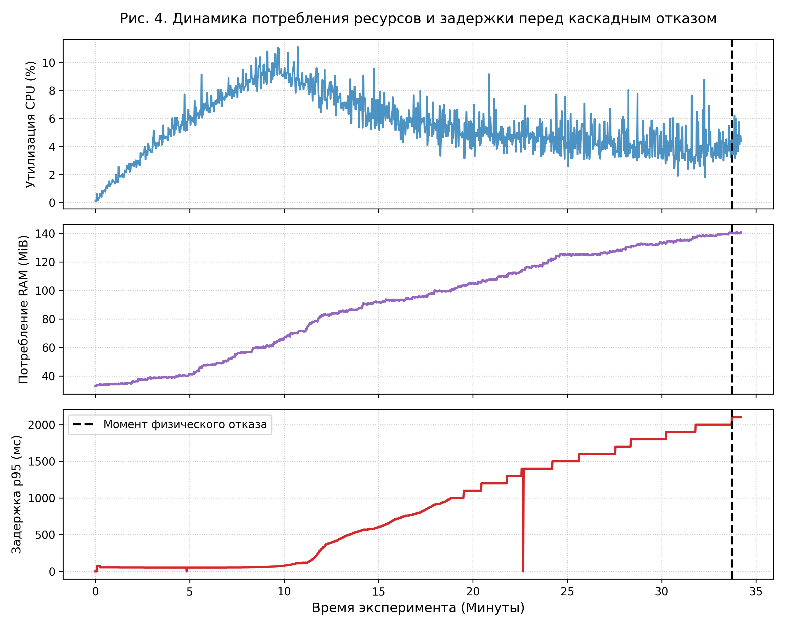
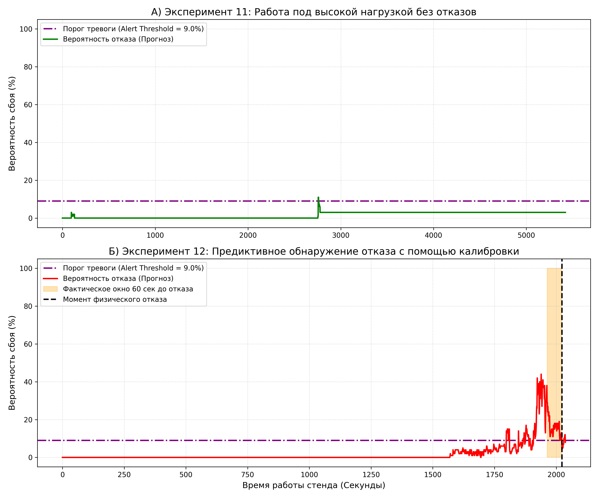

# Predictive SRE: Прогнозирование лавинообразной деградации асинхронных сервисов

[](https://www.python.org/)
[](https://fastapi.tiangolo.com/)
[](https://www.docker.com/)
[](https://locust.io/)
[](https://scikit-learn.org/)

Тестовый стенд и аналитический пайплайн для раннего обнаружения каскадных сбоев в асинхронных веб-приложениях.

---

## 🎯 Проблема

Штатный мониторинг реагирует слишком поздно. Задержка p95 и число ошибок взлетают, когда очередь запросов уже забита до отказа.

В сервисах на AsyncIO узкое место прячется внутри одного процесса. Фоновые утечки памяти или синхронные блокировки тормозят цикл событий (Event Loop). При этом метрики CPU и RAM долго держатся на нормальном уровне.

Стенд решает эту задачу упреждающим контролем. Алгоритм отслеживает микрозадержки цикла событий и предупреждает об аварии за 40–50 секунд до пробития SLA.

---

## 📊 Результаты тестов

Модель прошла проверку на независимых сериях нагрузочных тестов.

| Показатель | Значение | Практический эффект |
| :--- | :--- | :--- |
| **ROC-AUC** | **0.97** | Надежное отделение штатной нагрузки от деградации |
| **Окно раннего сигнала** | **40–50 секунд** | Время на прогрев реплик и перенаправление трафика |
| **Ложные тревоги (FP)** | **0%** | Нулевой уровень ложных алертов при пиковом трафике |
| **Порог SLA** | **p95 > 2000 мс** | Критерий физического отказа сервиса |
| **Подбор порога** | **Youden's J** | Точный баланс чувствительности и специфичности |

---

## 📈 Динамика сбоя и поведение алгоритма

### Физика отказа
График фиксирует лавинообразный скачок задержки после исчерпания лимитов памяти:



### Поведение модели под нагрузкой
Алгоритм игнорирует штатные всплески трафика и заранее бьет тревогу при аварии:



---

## 🛠 Архитектура тестового стенда

Система состоит из четырех компонентов.

1. **Сервис на FastAPI**
   - Промежуточное ПО замеряет лаг цикла событий (`X-Event-Loop-Lag`).
   - Тестовые ручки имитируют утечки RAM и блокировку потока.

2. **Изоляция в Docker**
   - Контейнер ограничен через cgroups: 1 ядро CPU и 1536 МБ памяти.
   - Лимиты воспроизводят реальные аварии по перегрузке и OOM Kill.

3. **Нагрузка через Locust**
   - Модуль `FluctuatingLoadShape` генерирует трафик от 200 пользователей.
   - Профиль нагрузки: 99.9% штатных запросов и редкие скрытые триггеры деградации.
   - Запись клиентских таймингов и заголовков ответа в реальном времени.

4. **Аналитический конвейер**
   - Сведение метрик Locust, лага Event Loop и счетчиков Docker в единый датасет.
   - Расчет остаточного ресурса до отказа (Remaining Useful Life).
   - Расчет скользящих средних, волатильности и трендов за 5, 15 и 30 секунд.
   - Обучение Random Forest с автоподбором порога срабатывания по Юдену.

---

## 📁 Файловая структура

```text
├── analytics/
│   ├── 02_prepare_dataset.py       # Сведение и очистка телеметрии
│   ├── 04_feature_engineering.py   # Генерация временных признаков
│   ├── 06_train_classifier.py      # Обучение модели и калибровка порога
│   ├── 07_plot_raw_metrics.py      # Построение графиков деградации
│   └── requirements.txt            # Зависимости аналитики
├── backend/
│   ├── app/
│   │   ├── api.py                  # Эндпоинты сервиса и хаос-тестов
│   │   ├── degradation/            # Модули утечки RAM и задержек
│   │   └── main.py                 # Приложение FastAPI и middleware
│   ├── Dockerfile                  # Образ Python 3.11-slim
│   └── requirements.txt            # Зависимости бэкенда
├── infrastructure/
│   └── docker-compose.yml          # Стенд с квотами cgroups
├── load_testing/
│   ├── locustfile.py               # Профиль стохастической нагрузки
│   └── system_monitor.py           # Посекундный сбор метрик хоста
├── docs/                           # Данные прогонов и протоколы тестов
├── run_analytics.ps1               # Запуск полного цикла обучения
├── run_load_test.ps1               # Headless-запуск теста Locust
└── start_monitoring.ps1            # Сбор метрик Docker в CSV
```

---

## 🚀 Быстрый запуск

### 1. Подготовка окружения

```bash
git clone https://github.com/username/analytical-load-testing.git
cd analytical-load-testing
python -m venv .venv
source .venv/bin/activate  # Для Linux/macOS
# .\.venv\Scripts\Activate.ps1  # Для Windows
pip install -r analytics/requirements.txt locust
```

### 2. Запуск сервиса в Docker

```bash
cd infrastructure
docker compose up -d --build
cd ..
```

Сервер слушает порт 8000. Проверка доступности: `GET /health`.

### 3. Сбор данных и нагрузочный тест

В первом терминале запустите сбор метрик контейнера:

```powershell
.\start_monitoring.ps1
```

Во втором терминале запустите генератор трафика:

```powershell
.\run_load_test.ps1
```

### 4. Обучение модели и построение графиков

После завершения тестов запустите аналитический скрипт:

```powershell
.\run_analytics.ps1
```

Конвейер соберет витрину признаков, обучит Random Forest и сформирует графики.

---

## 💡 Применение в SRE

- Упреждающее масштабирование: 40 секунд хватает на старт новых подов в Kubernetes до переполнения очередей.
- Защита контура: ранний Circuit Breaking отсекает сбоящий узел до падения смежных микросервисов.
- Точность сигналов: отсутствие ложных тревог бережет ресурсы от холостого автоскейлинга.