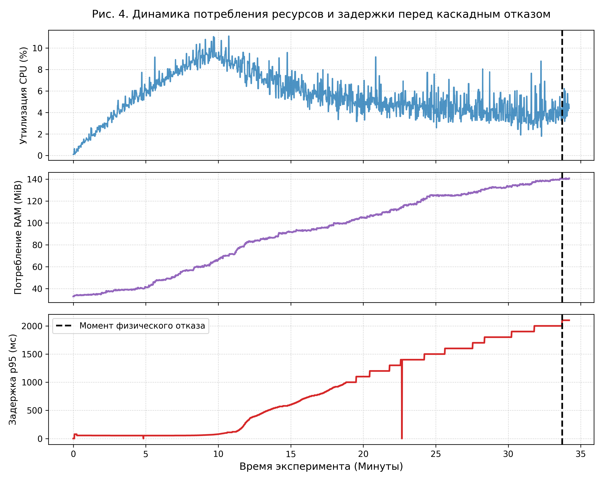

# High-Performance FastAPI: Диагностика и профилирование Event Loop под нагрузкой

[](https://github.com/SolarWarlock/Analytical_Load_Testing_and_Degradation_Forecasting/actions/workflows/ci.yml)
[](https://www.python.org/)
[](https://fastapi.tiangolo.com/)
[](https://www.uvicorn.org/)
[](https://www.docker.com/)
[](https://prometheus.io/)
[](https://locust.io/)

Бэкенд на FastAPI с кастомным middleware для замера лагов цикла событий (Event Loop) и экспортом метрик в Prometheus под высокой нагрузкой.

---

## 🎯 О чем проект

Главная уязвимость асинхронных веб-приложений - блокировка общего цикла событий. Достаточно одной тяжелой синхронной функции или утечки памяти, чтобы Uvicorn перестал вовремя отдавать управление ожидающим корутинам.

Внешний мониторинг замечает проблему слишком поздно. Очередь запросов переполняется, а задержка p95 взлетает лавинообразно. 

Проект реализует механизм внутреннего профилирования FastAPI. Сервер самостоятельно замеряет микрозадержки планировщика и передает телеметрию клиенту прямо в HTTP-заголовках ответа.

---

## ⚙️ Ключевые решения в бэкенде

### 1. Перехват лага цикла событий через ASGI Middleware
Кастомный middleware замеряет время, за которое планировщик Python возвращает управление корутине, и сразу обновляет метрики Prometheus.

```python
@app.middleware("http")
async def measure_event_loop_lag(request: Request, call_next):
    if request.url.path == "/metrics":
        return await call_next(request)

    lag_start = time.perf_counter()
    await asyncio.sleep(0)
    lag = time.perf_counter() - lag_start

    EVENT_LOOP_LAG_SECONDS.observe(lag)
    EVENT_LOOP_LAG_CURRENT_SECONDS.set(lag)

    response = await call_next(request)
    response.headers["X-Event-Loop-Lag"] = str(lag)
    return response
```

Телеметрия пишется в двух форматах. Для стендовых прогонов и ML-анализа лаг дублируется в заголовок `X-Event-Loop-Lag`, а для онлайн-мониторинга отдается на `/metrics`.

### 2. Экспорт метрик в Prometheus (pull-модель)
Сервис публикует метрики на `GET /metrics` через `prometheus-client`, а контейнер Prometheus опрашивает таргет `fastapi-backend:8000` каждые 5 секунд.

| Метрика | Тип | Что измеряет |
| :--- | :--- | :--- |
| `fastapi_event_loop_lag_seconds` | `Histogram` | Распределение задержек планировщика по бакетам от 0.5 мс до 5 с |
| `fastapi_event_loop_lag_current_seconds` | `Gauge` | Последнее измеренное значение лага цикла событий |
| `http_requests_total` | `Counter` | Счетчик HTTP-запросов с лейблами `method`, `endpoint`, `status` |
| `http_request_duration_seconds` | `Histogram` | Время обработки HTTP-запросов для расчета p95 и p99 |
| `degradation_leaked_memory_bytes` | `Gauge` | Накопленный объем эмулированной утечки памяти в байтах |
| `degradation_blocking_delay_seconds` | `Gauge` | Текущая синхронная задержка, внесенная в обработчик |

В лейбл `endpoint` подставляется шаблон маршрута FastAPI (`route.path`), а не сырой URL. Это защищает хранилище Prometheus от взрыва кардинальности на случайных 404-запросах.

Правила алертинга лежат в `infrastructure/prometheus/alert_rules.yml`. Правило `HighEventLoopLag` срабатывает при p95 лага выше 50 мс в течение 15 секунд — еще до роста ошибок 5xx.

### 3. Модульная архитектура роутера
Эндпоинты разделены по назначению через `APIRouter`.

| Метод | Эндпоинт | Назначение |
| :--- | :--- | :--- |
| `GET` | `/health` | Базовый health-check реактивности сервиса |
| `GET` | `/metrics` | Экспорт телеметрии в формате Prometheus |
| `GET` | `/workload/normal` | Асинхронная полезная нагрузка (`asyncio.sleep`) |
| `POST` | `/degradation/memory` | Имитация утечки памяти через накопление байтовых массивов |
| `POST` | `/degradation/slowdown` | Имитация синхронных CPU-блокировок в основном потоке |

### 4. Стресс-тестирование сервиса в Locust
Генератор создает стохастический поток от 200 пользователей. Профиль нагрузки эмулирует реальный трафик — 99.9% штатных вызовов и редкие фоновые сбои. Сценарий собирает сквозную статистику клиентских задержек и значений `X-Event-Loop-Lag`.

### 5. Контейнеризация и изоляция ресурсов
В `infrastructure/docker-compose.yml` поднимаются два сервиса в изолированной bridge-сети `monitoring`. Для `fastapi-backend` заданы строгие аппаратные квоты (`limits` и `reservations`) — 1 ядро CPU и 1536 МБ памяти, а также `healthcheck` по `/health`. Контейнер `prometheus` стартует после проверки `service_healthy` и хранит временные ряды в томе `prometheus_data` с retention 7 дней.

### 6. Автоматизация и CI/CD (GitHub Actions)
Пайплайн `.github/workflows/ci.yml` запускает четыре проверки на каждый push и pull request.
- Статический анализ Python-кода через `ruff`.
- Асинхронные смоук-тесты эндпоинтов, middleware и формата `/metrics` через `pytest`.
- Сборку Docker-образа бэкенда и валидацию `docker compose config`.
- Проверку синтаксиса `prometheus.yml` и `alert_rules.yml` через `promtool check config`.

---

## 📊 Результаты профилирования и аналитика

Совместный анализ логов Locust, счетчиков Docker и метрики `X-Event-Loop-Lag` показал четкую картину:

- **Ранний сигнал деградации.** Внутренний лаг цикла событий подскакивает за 40–50 секунд до роста ошибок HTTP 5xx.
- **Поведение под нагрузкой.** Сервис стабильно держит поток до момента блокировки потока или исчерпания буфера памяти.
- **Валидация гипотезы.** Аналитический классификатор на базе собранного датасета подтвердил точность метрики с ROC-AUC 0.97 при нуле ложных срабатываний.

### Динамика задержки и памяти перед отказом
На графике видно, как накопление утечки памяти и блокировок приводит к взрывному росту задержки p95:



---

## 📁 Структура репозитория

```text
├── .github/
│   └── workflows/
│       └── ci.yml                  # Автоматический CI-пайплайн (Ruff, Pytest, Docker)
├── backend/
│   ├── app/
│   │   ├── api.py                  # Роутер FastAPI и обработчики запросов
│   │   ├── metrics.py              # Реестр метрик Prometheus (Counter, Gauge, Histogram)
│   │   ├── degradation/            # Модули эмуляции утечек RAM и лагов CPU
│   │   │   ├── memory_leak.py      # Управляемое накопление памяти
│   │   │   └── slowdown.py         # Эмуляция задержек обработки
│   │   └── main.py                 # Инициализация FastAPI, middleware и /metrics
│   ├── tests/
│   │   └── test_api.py             # Смоук-тесты эндпоинтов и метрик Prometheus
│   ├── Dockerfile                  # Оптимизированный образ Python 3.11
│   └── requirements.txt            # Зависимости сервиса (FastAPI, Uvicorn, prometheus-client)
├── load_testing/
│   ├── locustfile.py               # Сценарий нагрузки и профиль 200 пользователей
│   └── system_monitor.py           # Посекундная телеметрия хоста
├── infrastructure/
│   ├── prometheus/
│   │   ├── prometheus.yml          # Конфигурация scrape-таргетов (5s interval)
│   │   └── alert_rules.yml         # Правила алертинга по лагу, 5xx и доступности
│   └── docker-compose.yml          # FastAPI с квотами ресурсов + Prometheus
├── analytics/                      # Анализ телеметрии и проверка гипотез
├── docs/                           # Протоколы нагрузочных прогонов
├── run_load_test.ps1               # Запуск стресс-теста Locust
└── start_monitoring.ps1            # Сбор системной телеметрии контейнера
```

---

## 🚀 Локальный запуск и проверка

### 1. Запуск через Docker Compose (рекомендуется)

```bash
cd infrastructure
docker compose up -d --build
```

Сервер доступен по адресу `http://localhost:8000`, Swagger UI — на `http://localhost:8000/docs`, интерфейс Prometheus — на `http://localhost:9090`.

Проверить сырой экспорт метрик можно запросом `curl http://localhost:8000/metrics`, а статус скрапинга — на странице `http://localhost:9090/targets`.

### 2. Запуск напрямую через Python

```bash
cd backend
python -m venv .venv
source .venv/bin/activate  # Для Linux/macOS
# .\.venv\Scripts\Activate.ps1  # Для Windows
pip install -r requirements.txt
uvicorn app.main:app --host 0.0.0.0 --port 8000 --reload
```

### 3. Проверка работы middleware

Отправьте тестовый запрос и проверьте заголовок лага:

```bash
curl -i http://localhost:8000/workload/normal
```

В ответе придет заголовок `X-Event-Loop-Lag`:

```http
HTTP/1.1 200 OK
content-type: application/json
x-event-loop-lag: 0.00010204315185546875
content-length: 39
```

### 4. Запуск нагрузочного теста Locust

Установите Locust и запустите сценарий:

```bash
pip install locust
locust -f load_testing/locustfile.py --host http://localhost:8000
```

Веб-интерфейс генератора откроется на `http://localhost:8089`.

---

## 🛠 Технологический стек бэкенда

- Язык — Python 3.11 / 3.13 (асинхронные корутины, типизация Pydantic).
- Фреймворк — FastAPI и ASGI-сервер Uvicorn.
- Мониторинг — Prometheus (`prometheus-client`, `/metrics`, `prometheus.yml`, `alert_rules.yml`).
- Среда запуска — Docker Compose (квоты CPU/RAM, healthchecks, bridge-сеть, том TSDB).
- CI/CD — GitHub Actions (Ruff, Pytest, сборка Docker, валидация Compose и `promtool`).